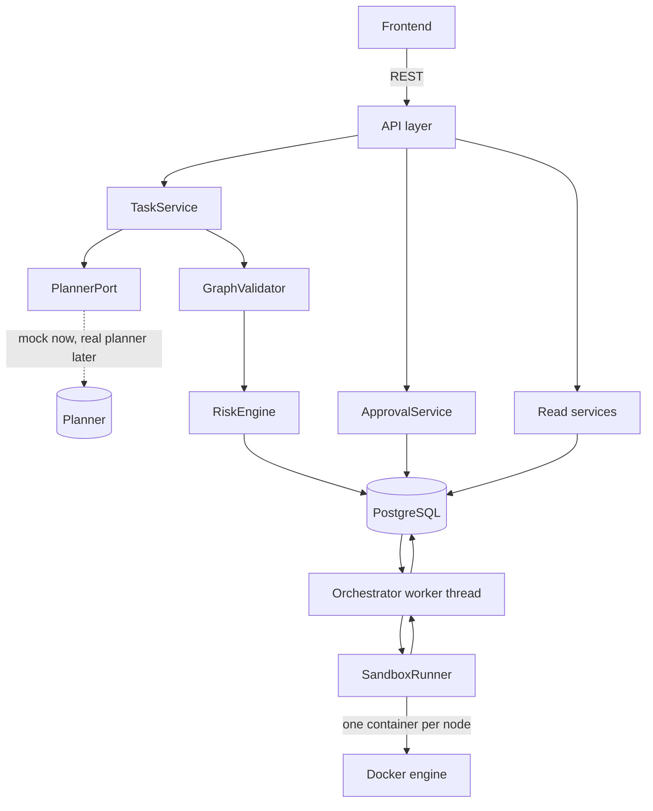

# AI Copilot — Backend Architecture

Scope: the backend MVP. Planner internals and the frontend are out of scope; their contracts with the backend are defined in "Interfaces".

## Chosen design

A **modular monolith**: one FastAPI process containing the API, the services, the validation and risk engine, and one background worker thread that executes plans. All state lives in PostgreSQL. Each action runs in its own short-lived Docker container.

The executor sits behind an interface and holds no state of its own, so it can later move into a separate worker process fed by a queue without changing the rest of the system.

## Alternatives considered

Scores are 1–5, higher is better.

| Criterion | Weight | A. Modular monolith, in-process worker | B. Monolith + Redis queue + worker process | C. LangGraph orchestration |
|---|---|---|---|---|
| Time to build | 25 | 5 | 3 | 3 |
| Correctness of the trust boundary | 25 | 4 | 4 | 3 |
| Complexity | 15 | 5 | 3 | 2 |
| Risk | 15 | 4 | 3 | 2 |
| Evolvability | 10 | 4 | 5 | 3 |
| Scalability | 5 | 2 | 5 | 4 |
| Cost | 5 | 5 | 4 | 4 |
| **Weighted total** | 100 | **4.4** | **3.6** | **2.8** |

- **B rejected for now:** a queue, a second process and Redis add setup and failure modes that a single-user demo does not need. It is the planned next step after the MVP.
- **C rejected:** it would put orchestration inside a framework that also wants to own planning, which belongs to another team member, and its pause/resume model duplicates state we already persist in PostgreSQL.

## System diagram



## Components

| Component | Location | Responsibility |
|---|---|---|
| API layer | `backend/app/api/` | HTTP only: parse, call a service, shape the response. No business logic. |
| Task service | `backend/app/services/task_service.py` | Stores the intent, calls the planner port, runs validation and risk, persists plan and nodes in one transaction. |
| Planner port | `backend/app/integrations/planner/` | Interface `plan(prompt, context) -> PlannerResult`, plus the mock. The real adapter is added by the planner owner. |
| Graph validator | `backend/app/validation/graph_validator.py` | Structural and schema checks on the planner's graph. |
| Action registry | `backend/app/validation/actions.py` | The known action types and the Pydantic model for each one's parameters. |
| Risk engine | `backend/app/validation/risk_engine.py` | Applies active safety rules; returns a risk level and the rules that matched. |
| Approval service | `backend/app/services/approval_service.py` | Records decisions and moves nodes. |
| State machine | `backend/app/services/state.py` | The only code allowed to change a node or plan state. Writes the audit row in the same transaction. |
| Orchestrator | `backend/app/execution/orchestrator.py` | Worker thread: picks the next runnable node, runs it, records the outcome, finishes the plan. |
| Sandbox runner | `backend/app/integrations/docker/sandbox.py` | Runs one action in a container with the sandbox profile and returns a result object. |
| Persistence | `backend/app/database/` | Models, repository functions, sessions. Already built. |

ORM models stay in `backend/app/database/models.py`. The empty `backend/app/models/` folder is not used.

## Data model

No schema change is made in the MVP. The existing 12 tables are used as follows.

| Concept | Stored as |
|---|---|
| Task | An `intents` row. `task_id` is the intent ID. Its status is derived from the latest plan. |
| Plan | A `plans` row. `status` is one of `rejected`, `validated`, `running`, `completed`, `failed`. |
| Graph edges and node keys | `plans.graph_snapshot` (JSONB): the validated graph, with each planner node key mapped to its `plan_nodes.id`. |
| Node | A `plan_nodes` row: `action_type`, `action_payload`, `risk_level`, `state`. |
| Approval | A `node_approvals` row, written when a decision is made. A pending approval is a node in state `waiting_approval`. |
| Attempt | An `executions` row with `attempt_number` and status. |
| Output | `execution_observations` rows of type `exit_code`, `stdout`, `stderr`, `duration_ms`. |
| Sandbox | One seeded `environments` row named `local-docker-sandbox`. |
| Policy | `safety_rules` rows, seeded. |
| History | `audit_logs` rows keyed by `related_entity_type` and `related_entity_id`. |

### Task status mapping

| Task status | Condition |
|---|---|
| `CREATED` | Intent stored, no plan yet |
| `PLANNED` | Latest plan is `validated` |
| `EXECUTING` | Latest plan is `running` |
| `COMPLETED` | Latest plan is `completed` |
| `FAILED` | Latest plan is `rejected` or `failed` |

### Node state machine

```
pending ──validation──► ready                (risk low)
pending ──validation──► waiting_approval     (risk medium or high)
waiting_approval ──approved──► ready
waiting_approval ──rejected──► skipped
ready ──execution succeeded──► completed
ready ──execution failed or timed out──► failed
any not-yet-run node whose dependency is failed or skipped ──► skipped
```

"Running" is not a node state. A node is running while it has an `executions` row with status `running`.

A plan with any critical-risk or invalid node is rejected as a whole and none of its nodes become runnable.

Nodes are immutable once the plan is validated. That is what ties an approval to the exact action that was shown.

## Data flow

**Submit**
1. `POST /tasks` with `session_id` and `prompt`.
2. Task service stores the intent and calls the planner port.
3. The validator checks the returned graph. On failure the plan is stored as `rejected` with reasons and the flow ends.
4. The risk engine scores each node. A critical node rejects the plan.
5. Plan, nodes and snapshot are written in one transaction. Plan status is `validated`.

**Approve**
1. The UI lists nodes in `waiting_approval`.
2. `POST /nodes/{node_id}/approval` records the decision and moves the node.

**Execute**
1. `POST /plans/{plan_id}/start` sets the plan to `running` and wakes the worker.
2. The worker selects a `ready` node whose dependencies are all `completed`, locking it with `FOR UPDATE SKIP LOCKED`.
3. It writes an `executions` row with status `running`, calls the sandbox runner, then writes observations and the final execution status.
4. It moves the node to `completed` or `failed` and skips dependents of a failed node.
5. When no node is `ready` or `waiting_approval`, the plan becomes `completed` if every node completed, otherwise `failed`.

**Recover**
On startup, any execution still marked `running` is set to `failed` with an explanatory message, its node is failed, and containers carrying the sandbox label are removed.

## Interfaces

### Planner graph contract, version 1 (consumed by the backend)

To be agreed with the planner owner before it is frozen.

```json
{
  "contract_version": "1",
  "planner": { "name": "mock", "version": "0.1.0" },
  "intent": { "summary": "Print the Python version", "confidence": 0.9 },
  "nodes": [
    {
      "key": "n1",
      "action_type": "run_command",
      "description": "Show the interpreter version",
      "params": { "argv": ["python", "--version"], "timeout_s": 30 }
    }
  ],
  "edges": [ { "from": "n1", "to": "n2" } ]
}
```

Rules enforced by the backend: 1–20 nodes; unique `key` values; every edge endpoint is an existing key; no cycles; `action_type` is registered; `params` match that action's schema. Any `risk` field sent by the planner is ignored.

### REST API (exposed by the backend)

Response shapes are to be confirmed with the frontend owner.

| Method and path | Purpose |
|---|---|
| `GET /health` | API and database status |
| `POST /sessions` | Create a session for the seeded user |
| `POST /tasks` | Submit a prompt; returns `task_id`, `plan_id`, `status` |
| `GET /tasks`, `GET /tasks/{task_id}` | List or read tasks |
| `GET /plans/{plan_id}` | Plan with `nodes` (id, key, action, params, risk, state) and `edges` |
| `POST /plans/{plan_id}/start` | Begin execution |
| `GET /approvals` | Nodes waiting for approval |
| `POST /nodes/{node_id}/approval` | Body: `decision` (`approved` or `rejected`), optional `comment` |
| `GET /nodes/{node_id}/executions` | Attempts for a node, with observations |
| `GET /logs` | Audit entries, filtered by `entity_type` and `entity_id`, paginated |

Errors use one shape: `{ "success": false, "message": "...", "data": { "reasons": [...] } }`.

## Sandbox profile

Applied to every action container through the Docker SDK for Python.

| Control | Setting |
|---|---|
| Image | One pinned image, `python:3.12-alpine` |
| Network | `network_disabled=True` |
| Memory | `mem_limit="256m"`, `memswap_limit="256m"` (no swap) |
| CPU | `nano_cpus=1_000_000_000` (one CPU) |
| Processes | `pids_limit=64` |
| Privileges | `cap_drop=["ALL"]`, `security_opt=["no-new-privileges"]` |
| User | Non-root, `65534:65534` |
| Filesystem | `read_only=True`; `tmpfs` at `/tmp`; a per-plan volume at `/workspace` |
| Time | `wait(timeout=...)`; on timeout the container is killed and the attempt recorded as `timed_out` |
| Output | stdout and stderr read separately, each capped at 64 KB and flagged if cut |
| Cleanup | Container removed in a `finally` block; the plan volume removed when the plan ends |
| Labelling | `ai-copilot.sandbox=1` plus plan and node IDs, used by the startup sweep |

Facts this profile relies on, from the documentation:

- A container has no resource limits unless they are set ([Docker resource constraints](https://docs.docker.com/engine/containers/resource_constraints/)).
- Only trusted users should control the Docker daemon, and a container given a host path can change the host ([Docker Engine security](https://docs.docker.com/engine/security/)). So only the backend talks to the daemon, the Docker socket is never mounted into a sandbox, and no host directory is ever mounted.
- The keyword arguments above exist in the SDK, and `Container.wait(timeout=...)` raises `requests.exceptions.ReadTimeout` on timeout ([docker-py containers](https://docker-py.readthedocs.io/en/stable/containers.html)).
- FastAPI's `BackgroundTasks` is intended for small follow-up work, so it is not used for execution ([FastAPI background tasks](https://fastapi.tiangolo.com/tutorial/background-tasks/)).

To be proven in the day-1 spike, because the pages read did not confirm them: `cap_drop=["ALL"]` is accepted and effective; the container has no network interface beyond loopback; a non-root user can write to the per-plan volume.

## Risk and policy

- Each active safety rule has a `pattern` (which action type and which parameter condition it matches) and a `risk_weight` between 0 and 1.
- A node's score is the highest weight among matching rules. Levels: below 0.3 low, below 0.6 medium, below 0.85 high, otherwise critical.
- A node no rule matches is **medium**, so anything unrecognised needs a human.
- An `argv[0]` outside the allowlist rule is critical.
- Policy: low runs without approval, medium and high wait for approval, critical rejects the plan.

## Scaling, security and cost notes

- **Scaling:** one worker runs one node at a time. This is a deliberate limit. The next step is option B: a queue and a worker process using the same executor interface.
- **Security layers:** action allowlist, argument lists instead of shell strings, backend-only risk scoring, the approval gate, and the sandbox profile. No single layer is relied on alone.
- **Not covered in the MVP:** authentication on the API, rate limiting, and secrets management. The API must not be exposed beyond localhost.
- **Cost:** none beyond local machines.

## Risks and mitigations

| Risk | Mitigation |
|---|---|
| The sandbox does not contain what it should | Day-1 spike with a test per limit; these tests stay in the suite |
| The planner contract changes late | Version the contract, agree it by day 2, build against the mock |
| Ten days is not enough | Must features only, one action type, small pull requests |
| State becomes inconsistent | One state-machine module, audit row in the same transaction, startup sweep |
| Docker behaves differently on a teammate's machine | Pinned image, documented setup, sandbox tests that anyone can run |
| Review queue blocks merges | Pull requests under about 300 lines, both teammates requested every time |
